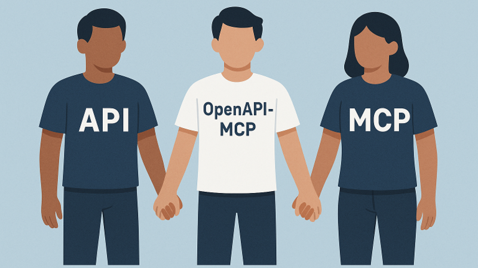

# OpenAPI to Model Context Protocol (MCP)

[](https://pypi.org/project/openapi-mcp-proxy/)
[](https://github.com/gujord/OpenAPI-MCP/blob/main/LICENSE)


OpenAPI-MCP exposes operations from an OpenAPI document as MCP tools. It also
provides schema resources, a usage prompt, and request previews. The server uses
FastMCP for MCP transport and tool registration.



**Release candidate: `2.0.0rc1`.** This candidate targets FastMCP 4.1.6 and MCP
Python SDK 2.3.0, with compatible minor updates allowed. Version 1.0.4 does not
contain these fixes. Read the [upgrade guide](https://github.com/gujord/OpenAPI-MCP/blob/main/docs/UPGRADING-2.md)
before upgrading an existing installation. See the
[review and validation record](https://github.com/gujord/OpenAPI-MCP/blob/main/docs/reviews/2026-11-05-security-and-compatibility.md)
for tested versions, findings, and remaining work.

## Install and run

Python 3.10 or later is required. Install the candidate explicitly:

```bash
pip install 'openapi-mcp-proxy==2.0.0rc1'
```

To use this checkout:

```bash
python -m venv .venv
source .venv/bin/activate
pip install -e .
OPENAPI_URL="./test/fixtures/petstore.json" \
MCP_ALLOWED_OPERATIONS='["GET /pets"]' \
SERVER_NAME="petstore" openapi-mcp
```

The default transport is **stdio**. A client launches the process and communicates
through its standard input and output. `OPENAPI_URL` accepts a local JSON/YAML
file or an HTTP(S) URL. Use specifications and API endpoints you trust.

A stdio client configuration can use the installed executable:

```json
{
  "mcpServers": {
    "petstore": {
      "command": "/absolute/path/to/.venv/bin/openapi-mcp",
      "env": {
        "OPENAPI_URL": "/absolute/path/to/OpenAPI-MCP/test/fixtures/petstore.json",
        "SERVER_NAME": "petstore",
        "MCP_ALLOWED_OPERATIONS": "[\"GET /pets\"]"
      }
    }
  }
}
```

For **Streamable HTTP**:

```bash
OPENAPI_URL="./test/fixtures/petstore.json" \
SERVER_NAME="petstore" \
MCP_ALLOWED_OPERATIONS='["GET /pets"]' \
MCP_HTTP_ENABLED=true \
MCP_HTTP_PORT=8001 \
openapi-mcp
```

The MCP endpoint is `http://127.0.0.1:8001/mcp`. The supplied
[client configuration](https://github.com/gujord/OpenAPI-MCP/blob/main/claude_desktop_config.json) uses `mcp-remote` to connect
stdio clients to HTTP. Client applications and `mcp-remote` are separate
components and were not tested in the offline review.

Legacy SSE is available explicitly with `MCP_TRANSPORT_TYPE=sse`, at `/sse`.
The default HTTP endpoint changed from `/sse` to `/mcp`; update existing clients.

## Choose which API operations to expose

By default, **no API operations are exposed**. Set `MCP_ALLOWED_OPERATIONS` to a
JSON array of exact uppercase HTTP method and OpenAPI path pairs:

```bash
MCP_ALLOWED_OPERATIONS='["GET /pets", "GET /pets/{petId}"]'
```

Selectors use the paths in the specification, without the server URL/base path.
They are literal matches, not regular expressions or wildcards. An unknown
selector, malformed list, duplicate selector, or conflicting policy stops startup.
Only permitted operations appear as tools, in the operation list, and in the
usage prompt. A direct call to an omitted tool is rejected before request
preparation or authentication. An empty list leaves only the information tools,
usage prompt, and schema resources available. API descriptions and component
schemas remain metadata; this policy is not a document-redaction feature.

To deliberately expose every operation, set `MCP_OPERATION_POLICY=all` and leave
`MCP_ALLOWED_OPERATIONS` unset. This restores the previous exposure behavior.
A policy applies to the entire server instance, not individual users. Restart
with a new server instance to apply changes. A GET-only list is not a guarantee
of harmless operations; choose each route based on what its API actually does.

Operation IDs that collide after name sanitization, or permitted IDs that collide
with management tool names, are rejected instead of silently replacing a tool.

## Tools and request previews

Each permitted API operation becomes a tool named `<server_name>_<operation_id>`.
Inputs use the parameter names from the specification, including names such as
`customerId` or `X-Trace`. JSON request bodies use the argument `body`.
Required fields and supported JSON Schema constraints are checked before an API
request. Local `#/components/schemas/` references are supported; external schema
references are not fetched.

Every generated operation accepts two additional arguments:

- `dry_run: true` returns the prepared URL, parameters, caller-supplied headers,
  and body without executing the API request or obtaining an authentication token.
  Server-configured authentication headers are omitted from the preview.
- `req_id` is an optional correlation string.

For example, a tool with a `customerId` path parameter and JSON request body can
be called with:

```json
{"customerId": "c1", "body": {"quantity": 2}, "dry_run": true}
```

Previews still contain caller-supplied data. They are not a general redaction
service. `dry_run`, `req_id`, and `kwargs` are reserved names; specifications that use them,
or reuse one input name across locations, are rejected rather than silently
mapped to the wrong input.

Additional tools list operations and server information. Component schemas are
available as JSON resources under `schema://<server_name>_<schema_name>` (with
sanitized names), and a generated prompt describes API usage.

## Configuration

Environment variables and a local `.env` file configure the executable.
The Python API also exposes `ServerConfig.from_file()` for JSON/YAML settings.
Process environment overrides `.env`, which overrides file values. Loading a
file does not modify the process environment or other server instances.

| Variable | Meaning | Default |
| --- | --- | --- |
| `OPENAPI_URL` | Trusted specification URL or local file | Required |
| `SERVER_NAME` | Prefix for tools and resources | `openapi_proxy_server` |
| `MCP_OPERATION_POLICY` | `allowlist` or explicit `all` | `allowlist` |
| `MCP_ALLOWED_OPERATIONS` | JSON array of exact `METHOD /path` selectors | `[]` (no API operations) |
| `MCP_HTTP_ENABLED` | Enable HTTP instead of stdio | `false` |
| `MCP_HTTP_HOST` | Address to bind | `127.0.0.1` |
| `MCP_HTTP_PORT` | Port | `8000` |
| `MCP_TRANSPORT_TYPE` | `http` or legacy `sse` | `http` |
| `MCP_ALLOWED_HOSTS` | Additional trusted HTTP Host values, comma-separated | FastMCP loopback defaults |
| `MCP_CORS_ORIGINS` | Allowed HTTP Origin values, comma-separated | localhost and 127.0.0.1 on ports 3000 and 8080 |
| `MCP_AUTH_HEADERS` | Upstream headers as JSON or `key=value,key2=value2` | Empty |
| `OAUTH_CLIENT_ID`, `OAUTH_CLIENT_SECRET`, `OAUTH_TOKEN_URL` | Upstream OAuth client credentials | Unset |
| `OAUTH_SCOPE` | Upstream OAuth scope | `api` |
| `API_USERNAME`, `API_PASSWORD`, `API_LOGIN_ENDPOINT` | Upstream username/password login | Unset |
| `HTTP_TIMEOUT` | Upstream request timeout in seconds | `30` |
| `HTTP_MAX_RETRIES` | Retries for idempotent HTTP methods | `3` |
| `HTTP_RETRY_BASE_DELAY`, `HTTP_RETRY_MAX_DELAY` | Retry delays in seconds | `1`, `30` |
| `MCP_DEBUG` | Enable debug logging | `false` |

`MCP_CORS_ORIGINS` is retained as a configuration name for compatibility; it
controls Origin validation in the FastMCP transport, not MCP client identity or
a complete browser CORS policy. HTTP Host/Origin protection is enabled explicitly.

The old `MCP_MESSAGE_SIZE_LIMIT`, `MCP_BATCH_TIMEOUT`, `MCP_SESSION_TIMEOUT`, and
`SSE_*` settings belong to legacy modules. They do not configure limits or
transport selection in the current `openapi-mcp` executable.

### Upstream authentication

```bash
OPENAPI_URL="./specs/my-api.yaml" \
MCP_AUTH_HEADERS='{"X-API-Key": "example-placeholder"}' \
MCP_ALLOWED_OPERATIONS='["GET /items"]' \
openapi-mcp
```

These credentials authenticate **outgoing API calls**, not incoming MCP clients.
Anyone allowed to call this MCP server can invoke its registered API operations
with the server's API privileges. The operation allowlist limits those tools,
but there is no per-user authorization layer yet. Use restricted API credentials
and allow only the operations you intend to expose. See [SECURITY.md](https://github.com/gujord/OpenAPI-MCP/blob/main/SECURITY.md).

A configured token login that fails now stops the API request. POST and PATCH
requests are not retried automatically, because a lost response may hide a
successful mutation. GET, HEAD, OPTIONS, PUT, and DELETE may be retried according
to the configured limit; set `HTTP_MAX_RETRIES=0` if the API does not implement
those methods idempotently. Numeric `Retry-After` delays are bounded by the
configured maximum; HTTP-date values fall back to exponential delay.

## Docker

```bash
docker compose up --build -d
```

The example services publish ports 8001 and 8002 on **127.0.0.1 only**. The
process binds to `0.0.0.0` inside each container. Both example services fetch
public specifications at startup. `GET /health` reports process liveness; it
does not test upstream authentication or API availability. Health checks fail
on HTTP errors. Container builds were not exercised in the local review.

## Development and current scope

```bash
pip install -e '.[dev]'
python -m pytest test/ -q
```

Normal tests block network sockets, isolate credentials, and use fixtures or
mock HTTP responses. Eleven legacy live examples are skipped explicitly.
Returning a value from a test is an error, so returning `False` cannot masquerade
as a passing assertion. See [CONTRIBUTING.md](https://github.com/gujord/OpenAPI-MCP/blob/main/CONTRIBUTING.md) for the checks and
the opt-in command for legacy live examples.

This is a custom OpenAPI adapter, not a complete OpenAPI implementation.
Selected operations with unsupported request formats are rejected at startup:
form/multipart/XML bodies, array/object path/query/header values, cookie inputs,
parameter references/content, and nondefault serialization styles. Direct JSON
bodies and scalar path/query/header parameters are supported. Explicit null
JSON bodies are rejected before authentication. Unsupported omitted operations
may remain in the specification. Response size limits and per-user MCP
authorization still require more work. Deprecated server
and transport modules remain for historical compatibility and have not received
the same end-to-end validation as `fastmcp_server.py`.

[FastMCP's native OpenAPI integration](https://gofastmcp.com/integrations/openapi)
handles additional request formats. The [adapter comparison and policy review](https://github.com/gujord/OpenAPI-MCP/blob/main/docs/reviews/2026-11-05-operation-policy-and-adapters.md)
records a shared-fixture comparison, including differences in body input shapes,
argument validation, and request previews. The current adapter remains in use;
a replacement must preserve those contracts. The comparison script reports
known gaps with a nonzero exit status:

```bash
python scripts/compare_openapi_adapters.py --output build/adapter-comparison.json
```

The [initial review](https://github.com/gujord/OpenAPI-MCP/blob/main/docs/reviews/2026-11-05-security-and-compatibility.md) also
covers the July 2026 MCP protocol changes. Updating the SDK alone is not proof
of complete protocol conformance.

## License

[MIT](https://github.com/gujord/OpenAPI-MCP/blob/main/LICENSE).
